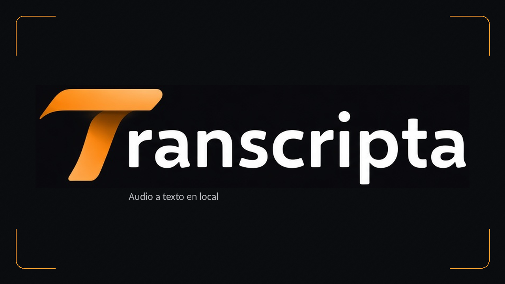

<div align="center">



**Transcripta** · Versión 2 · by YuzVax

Convierte audio y vídeo en texto, subtítulos y traducciones desde tu propio equipo.

[Descargar Transcripta_v2.exe](https://github.com/YuzVax/Transcripta-App/releases/latest/download/Transcripta_v2.exe)
·
[Todas las versiones](https://github.com/YuzVax/Transcripta-App/releases)
·
[Guía de uso](docs/GUIA_DE_USO.md)

</div>

---

## Qué es

Transcripta es una aplicación para **Windows 10 y 11** que transcribe audio y vídeo y permite traducir el resultado **en local**. El audio no se envía a un servicio de transcripción: el procesamiento se hace en tu PC.

Interfaz en castellano, tema oscuro y la identidad naranja de **YuzVax**, en la misma línea que [OptimiZation](https://github.com/YuzVax/OptimiZation-App). Una herramienta pensada para uso personal, compartida gratuitamente.

---

## Cómo empezar (lo más fácil)

Solo necesitas el archivo `.exe`. **No hace falta instalar Python, FFmpeg ni las dependencias por separado.**

### 1. Descarga

1. Entra en [Releases](https://github.com/YuzVax/Transcripta-App/releases).
2. En la última versión, descarga **`Transcripta_v2.exe`** dentro de **Assets**. Los archivos «Source code» no son la aplicación lista para abrir.
3. Guárdalo en una carpeta fácil de encontrar y espera a que termine la descarga.

### 2. Desbloquear el archivo (si Windows lo marca)

1. Clic derecho en `Transcripta_v2.exe` → **Propiedades**.
2. Si aparece la casilla **Desbloquear**, y has verificado que es la descarga oficial, márcala → **Aplicar** → **Aceptar**.

### 3. Abrir

1. Haz doble clic en `Transcripta_v2.exe`.
2. Espera a que termine **Preparando Transcripta**. El primer arranque extrae el motor incluido.
3. **No lo ejecutes como administrador**: no es necesario y puede impedir arrastrar archivos desde el Explorador.

> El ejecutable **no está firmado digitalmente**. Si aparece SmartScreen («Windows protegió su PC»), usa **Más información → Ejecutar de todas formas** únicamente si lo has descargado desde este repositorio y comprobado su integridad. No desactives el antivirus ni ignores una detección de malware. [Más información y SHA256](AVISO_SMARTSCREEN.md).

### 4. Primera transcripción

1. Empieza con **small**, el modelo más ligero de los tres disponibles.
2. Pulsa **Añadir archivos** o arrastra tus audios y vídeos a la ventana.
3. Elige el idioma o deja **Detectar automáticamente**.
4. Pulsa **Transcribir**. Si hace falta, se descargará el modelo antes de empezar.
5. Revisa el resultado y guárdalo en **TXT**, **SRT** o **VTT** antes de cerrar.

**Importante:** al cerrar se eliminan el motor extraído, los modelos descargados y los temporales de esa sesión. Tus archivos originales y los resultados que hayas exportado fuera de la sesión no se borran. En la siguiente sesión los modelos se descargan de nuevo.

---

## Qué puedes hacer

| Función | Para qué sirve |
|---------|----------------|
| **Transcribir** | Convertir voz de audio o vídeo a texto con faster-whisper |
| **Añadir varios archivos** | Procesar una cola, también mediante arrastrar y soltar |
| **Elegir modelo** | Usar small, medium o large-v3 según tu equipo |
| **Detectar idioma** | Reconocer automáticamente el idioma del audio |
| **Traducir** | Traducir el texto en local con Argos Translate |
| **Exportar** | Guardar texto TXT o subtítulos SRT y VTT |
| **Cancelar** | Detener la cola y conservar los resultados ya terminados |

Admite, entre otros, **OPUS de WhatsApp, MP3, M4A, WAV, OGG, FLAC y MP4**. La compatibilidad concreta depende del contenido y del códec del archivo.

### Idiomas

La selección de transcripción y los destinos de traducción incluyen **español, inglés, italiano, portugués, francés, alemán y ruso**.

La traducción descarga los paquetes necesarios bajo demanda. Si no existe un par directo, puede pasar por inglés; depende de los paquetes disponibles en Argos. **Detectar automáticamente** se refiere al idioma de entrada, no a un idioma de traducción.

### Modelos de voz

| Modelo | Cuándo elegirlo |
|--------|-----------------|
| **small** | Punto de partida; el más ligero y rápido de esta edición |
| **medium** | Mayor capacidad, con más consumo de memoria y tiempo |
| **large-v3** | El más grande; útil si priorizas calidad y tu equipo puede con él |

Un modelo es el conjunto de datos que el motor necesita para reconocer el audio. No garantiza una transcripción perfecta: el ruido, el idioma y la grabación influyen. **Esta edición del EXE trabaja en CPU**, también si tienes una GPU. Medium y large-v3 pueden tardar bastante.

---

## Requisitos

- **Windows 10 u 11 de 64 bits**.
- **.NET Framework 4.8**, habitual en Windows actualizado.
- Internet para descargar modelos y paquetes de traducción al usarlos en cada sesión.
- Espacio libre para extraer el motor y alojar los modelos: los grandes necesitan varios GB adicionales.
- Memoria y tiempo de CPU suficientes para el modelo elegido. No requiere CUDA ni una GPU.

Una vez descargado lo necesario, el procesamiento puede continuar sin conexión **dentro de esa sesión**.

---

## Alternativa: abrir desde el código fuente

Para desarrollo, con Python 3.11 y FFmpeg disponibles:

1. Descarga el código (**Code → Download ZIP**).
2. Ejecuta **`Instalar dependencias.bat`** una vez para crear el entorno e instalar las bibliotecas.
3. Abre la interfaz con **`Transcripta.bat`**.

Esta alternativa **no es el EXE portátil**: usa un entorno de desarrollo y no aplica automáticamente el aislamiento y la limpieza del lanzador empaquetado. Las dependencias fijadas del EXE y su proceso de construcción están en [packer/](packer/README.md).

---

## Privacidad y seguridad

- La transcripción y la traducción se procesan en tu equipo; no se suben los audios a una API de transcripción.
- Las descargas de modelos y de índices de idiomas sí requieren conexiones a sus proveedores.
- El EXE extrae su sesión en `%LocalAppData%\Transcripta\sesion-<id>\` y la elimina al cerrar.
- **Guarda tus resultados antes de cerrar.** Los resultados sin exportar se pierden.
- Al abrir otra vez la aplicación, el lanzador cierra la instancia anterior. Exporta primero para evitar pérdidas.
- La limpieza no es borrado forense y no elimina registros de Windows, del antivirus ni copias externas.
- La transcripción y la traducción pueden cometer errores. Revisa nombres, cifras y datos importantes.

Consulta la [guía de uso](docs/GUIA_DE_USO.md) y el [aviso de seguridad de Windows](AVISO_SMARTSCREEN.md).

---

## Contenido del repositorio

```text
Transcripta-App/
├── Transcripta.bat                inicio desde el código
├── Instalar dependencias.bat      preparación del entorno de desarrollo
├── requirements.txt
├── LICENSE
├── THIRD_PARTY_NOTICES.md
├── AVISO_SMARTSCREEN.md
├── CHANGELOG.md
├── src/                          interfaz, transcripción y traducción
├── assets/                       logotipo T e identidad de la aplicación
├── docs/                         banners y guía de uso
├── tests/                        pruebas de regresión
├── tools/                        herramientas de identidad visual
└── packer/                       lanzador, verificaciones y empaquetado
```

El ejecutable se publica en **Releases**, no dentro del código. La edición de distribución **v2.0.0** abre este repositorio; el EXE conserva la versión interna **1.1.10** y su SHA256 original. No es una recompilación funcional.

---

## Licencia

Los materiales propios publicados bajo los términos de este repositorio se ofrecen para uso **no comercial** (YuzVax): uso personal o educativo y distribución gratuita sin modificar, con los avisos correspondientes. No se permite venderlos ni explotarlos comercialmente sin permiso escrito. Ver [LICENSE](LICENSE).

Las versiones anteriores conservan los permisos que ya se les concedieron. El EXE reutilizado conserva los avisos y las licencias incluidos en su compilación original. Los componentes independientes de terceros mantienen sus respectivas licencias; esta licencia no las sustituye ni restringe. Ver [THIRD_PARTY_NOTICES.md](THIRD_PARTY_NOTICES.md).

---

<div align="center">

by **YuzVax**

</div>
